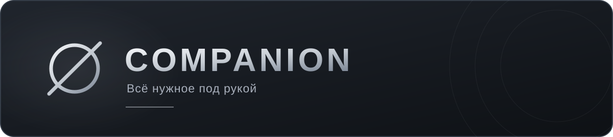
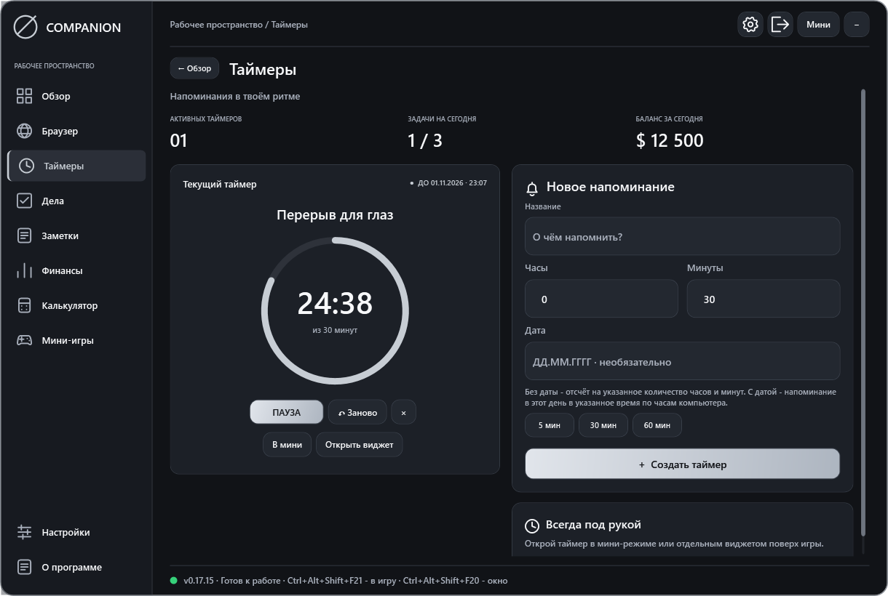

**Всё нужное под рукой, даже когда ты в игре.**

Companion помогает не забывать о делах, следить за временем, записывать важное и пользоваться браузером прямо поверх игры. Его можно настроить под себя и оставить только те окна, которые нужны сейчас.

Программа создавалась для игроков Majestic RP, но подходит для других игр, работы, учёбы и обычных повседневных дел.

**Бесплатно. Без регистрации в Companion.**

> [!IMPORTANT]
> **ЧТОБЫ COMPANION ОТОБРАЖАЛСЯ ПОВЕРХ ИГРЫ**
>
> В настройках самой игры включи **«ОКОННЫЙ РЕЖИМ»** или **«ОКНО БЕЗ РАМКИ»**.
>
> В полноэкранном режиме окна помощника могут быть не видны.

**[Скачать последнюю версию](https://github.com/yashkarpsher/companion/releases/latest)** · [Инструкция](docs/INSTALL.md) · [Что нового](CHANGELOG.md)

## Что умеет Companion

### Таймеры и напоминания

Поставь таймер на нужное количество часов и минут или выбери дату и время. Companion напомнит, когда пора вернуться к делу.

Таймер можно оставить в главном окне, открыть отдельным виджетом или вывести в мини-режим.

### Дела и заметки

Составляй планы, отмечай выполненное и записывай всё, что важно не забыть: кому одолжил деньги, о чём договорился или что нужно сделать позже.

Для записи на ходу есть быстрая заметка. Её можно вызвать горячими клавишами, не открывая главное окно.

### Браузер поверх игры

Смотри YouTube, открывай нужные сайты или включай сериал параллельно игре.

В браузере есть:

- вкладки;
- история посещений с поиском;
- закладки, которые можно переименовывать;
- отдельный ползунок громкости;
- закрепление поверх других окон;
- режим просмотра без рамки.

В маленьком окне страница занимает всё пространство. Компактная панель появляется снаружи при наведении на край. По центру находится кнопка «Переместить», чтобы удобно расположить браузер на экране.

### Финансы и накопления

Записывай доходы и расходы, чтобы видеть свой баланс. Создавай несколько целей накопления: например, на машину, квартиру и другие покупки.

У каждой цели свой баланс и прогресс. Можно пополнять одну цель, не меняя остальные.

### Калькулятор

Быстро посчитай нужную сумму прямо в помощнике. Поддерживаются скобки, проценты, степени и квадратный корень.

### Мини-игры

Небольшой перерыв между делами тоже нужен. В Companion есть:

- «Мистер Свин. Сундучок»;
- Subway Surfers: Санкт-Петербург;
- «Держи высоту», игра с механикой Flappy Bird;
- дурак с выбором режима;
- блэкджек на виртуальные фишки.

Игры работают без интернета. Громкость можно настроить ползунком.

## Настрой под себя

Выбери любимый цвет, поставь свою картинку на фон и настрой прозрачность. Сделай окно полностью непрозрачным или оставь видимой игру за ним.

Плитки разделов и мини-игр можно менять местами. Горячие клавиши тоже настраиваются.

Нужна только одна запись? Открой её отдельным виджетом. Хочется ещё компактнее? Переключись в мини-режим и подбери удобный размер.

Во время игры можно включить пропуск мыши: окна помощника останутся видны, а клики будут попадать в игру.

## Как установить

1. Открой [последний релиз](https://github.com/yashkarpsher/companion/releases/latest).
2. В разделе **Assets** скачай архив `Majestic-Companion-ВЕРСИЯ.zip`.
3. Распакуй архив целиком в отдельную папку.
4. Запусти **Majestic Companion.exe**.

Архивы **Source code** для обычного запуска не нужны.

Companion предназначен для Windows 10 и 11, 64-разрядных версий. Для браузера и некоторых игр нужен Microsoft Edge WebView2 Runtime. Если программа сообщит, что его нет, установи компонент с [сайта Microsoft](https://developer.microsoft.com/microsoft-edge/webview2/).

**Чтобы Companion отображался поверх игры, включи в настройках игры оконный режим или окно без рамки.**

При первом запуске появится обучение. Позже его можно открыть снова через раздел «О программе».

## Управление

Стандартные сочетания:

| Клавиши | Действие |
| --- | --- |
| Ctrl + Shift + M | Показать или скрыть Companion |
| Ctrl + Shift + G | Переключить управление между игрой и окнами помощника |
| Ctrl + Shift + N | Открыть быструю заметку |
| Ctrl + Enter | Сохранить быструю заметку |
| F11 в браузере | Переключить режим просмотра |
| Ctrl + L в браузере | Ввести адрес или поисковый запрос |

Свои сочетания можно выбрать в настройках.

**«В мини»** сворачивает главное окно до выбранной записи. **«Открыть виджет»** создаёт отдельное окно с этой записью.

Шестерёнка открывает настройки. Дверца полностью закрывает Companion, а кнопка сворачивания оставляет его работать в трее.

**Для уведомлений программа должна оставаться запущенной.**

## Обновления и сохранения

Companion проверяет обновления при запуске и предлагает установить новую версию. Проверить обновление вручную можно в настройках.

Без интернета помощник продолжает работать, а проверка обновлений пропускается.

Твои записи и настройки сохраняются в папке **`data`** рядом с программой. При встроенном обновлении они сохраняются автоматически.

Если обновляешь программу вручную:

1. Полностью закрой старую версию через дверцу или меню трея.
2. Распакуй новую версию.
3. Перенеси свою папку **`data`** в папку новой версии.

**Не удаляй `data`, если хочешь сохранить свои записи, настройки и игровой прогресс.**

Старые резервные копии обновлений очищаются автоматически. Одна последняя копия остаётся для восстановления.

Windows может показать предупреждение неизвестного приложения: у текущей сборки пока нет цифровой подписи издателя.

## Об авторе

Companion делает **Яша**.

- [TikTok: @rpsher_yasha](https://www.tiktok.com/@rpsher_yasha)
- [Telegram: @yashkarp](https://t.me/yashkarp)

Нашёл ошибку или придумал полезную функцию? Напиши в [Issues](https://github.com/yashkarpsher/companion/issues) или в Telegram.
